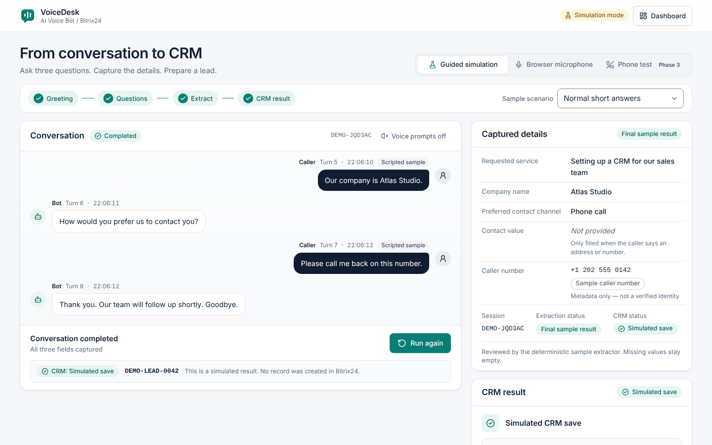

# VoiceDesk — Phase 1 presentation prototype

An AI phone bot asks a caller three short questions; their requested service, company and contact preference become structured data; a Bitrix24 lead follows. This repository holds **Phase 1** of five: a polished web prototype for presenting that flow to the client.

> **Phase 1 is a simulation.** No phone number, no NLP provider and no Bitrix24 connection exist yet. Guided answers are scripted, extraction is a deterministic rule-based mock, and every CRM result is simulated with a synthetic ID such as `DEMO-LEAD-0042`. Browser-microphone transcription is real when the browser provides it. See [docs/PHASE1_SCOPE.md](docs/PHASE1_SCOPE.md).

"VoiceDesk" is a working presentation label, not a registered brand or the client's company name.



## What's inside

| Route | Screen |
|---|---|
| `/` | Redirects to `/demo` |
| `/demo` | **Demo Studio** — guided simulation, browser microphone demo, phone test (Phase 3 placeholder) |
| `/dashboard` | Overview — sample workspace metrics, recent calls, setup progress, integration status |
| `/dashboard/calls` | Call History — search, filters, sorting, JSON export (filters live in the URL) |
| `/dashboard/calls/:id` | Call Details — transcript, captured fields, JSON, event timeline, replay |
| `/dashboard/agent` | Agent Setup — greeting, three ordered questions, clarification and completion wording |
| `/dashboard/integrations` | Connection states and the Bitrix24 field-mapping preview |
| `/dashboard/settings` | Voice prompts, demo pacing, motion, workspace and agent resets |

## Requirements

- Node.js **22.22 or later** (react-router 8 requires it) and npm 10+.
- For browser tests: a Chromium that Playwright can drive (see [Tests](#tests)).

## Install, run, build, preview

```bash
npm ci              # install exactly what package-lock.json pins
npm run dev         # development server with HMR → http://localhost:5173/demo
npm run build       # type-check (tsc -b) and build to dist/
npm run preview     # serve the production build → http://localhost:4173/demo
```

No environment variables, API keys or network services are needed. The app makes no network requests at runtime besides loading its own assets.

## Scripts

| Command | What it does |
|---|---|
| `npm run lint` | oxlint (the linter shipped with the official Vite React template) |
| `npm run typecheck` | `tsc -b` across app, Node config and e2e projects |
| `npm test` | Vitest unit tests for the state machine, controller, extractor, queries and exports |
| `npm run test:e2e` | Playwright browser tests against the production build |
| `npm run screenshots` | Re-captures `docs/screenshots/` at 1440, 1024, 768, 390 and 360 px |
| `npm run presentation` | Rebuilds the presentation slides (`docs/presentation/*.png` + PDF) from fresh screenshots |
| `npm run check` | lint + typecheck + unit tests + build |

## Tests

Unit tests run anywhere with `npm test`.

Browser tests build the app, start `vite preview` on port 4173 and drive Chromium:

```bash
npx playwright install chromium   # once, if you do not already have a Chromium for Playwright
npm run test:e2e
```

To use an existing Chromium instead of Playwright's download, point `PW_CHROMIUM_EXECUTABLE` at it:

```bash
PW_CHROMIUM_EXECUTABLE=/path/to/chromium npm run test:e2e
```

The browser tests replace the Web Speech API and `getUserMedia` with in-page fakes, so they cover the microphone flows (supported, unsupported, denied, no speech) without real audio. See [docs/VERIFICATION.md](docs/VERIFICATION.md) for what was and was not verified.

## Project structure

```
src/
  domain/        Typed contracts (types.ts), agent config + validation, rule-based extractor,
                 guided scenarios, Call History queries and metrics
  state/         sessionReducer.ts (pure state machine), demoController.ts (timers, voice,
                 session isolation), store.ts, timing.ts
  services/      types.ts (VoiceDeskService interface), mockService.ts (Phase 1 adapter),
                 browserVoice.ts (Web Speech adapter), sessionStore.ts, simulator.ts
  fixtures/      Eight sample sessions built by replaying the real reducer
  copy/          All user-facing English copy (en.ts)
  components/    ui/ primitives, layout/ shells, demo/ and calls/ feature components
  pages/         Demo Studio, dashboard pages, not-found
  lib/           Formatting, IDs, exports, downloads, guarded localStorage
e2e/             Playwright specs and the screenshot capture script
docs/            Scope, design system, Phase 2–4 handoff, verification, screenshots
```

## Deploying on Vercel

The repository includes [`vercel.json`](vercel.json), so no project settings need changing:

1. In Vercel, **Add New → Project** and import this GitHub repository.
2. Vercel detects **Vite**. The file sets the build command (`npm run build`) and output directory (`dist`).
3. Leave environment variables empty — Phase 1 needs none.
4. **Deploy.** Open `/demo` on the generated URL.

`vercel.json` also rewrites every unknown path to `index.html`, so deep links and page reloads such as `/dashboard/calls/SAMPLE-1004` work, and gives the hashed files in `/assets/` a one-year immutable cache. Vercel builds with a current Node.js (22.22 or later is required by `engines`).

The deployed page is public: anyone with the link can open it. That is fine for Phase 1 because it holds only fictional sample data and in-browser demo runs; real calls and customer data must wait for the access control in Phase 2.

### Other static hosts

`npm run build` produces a static single-page app in `dist/`. Because routes are handled in the browser, **the host must serve `index.html` for unknown paths** (SPA fallback); otherwise deep links and reloads return 404.

- **Netlify** — add `public/_redirects` containing `/*  /index.html  200`.
- **nginx** — `location / { try_files $uri $uri/ /index.html; }`.
- **Apache** — `FallbackResource /index.html`.
- **Caddy** — `try_files {path} /index.html`.

Serve hashed files in `dist/assets/` with long-lived cache headers and `index.html` with `no-cache`.

## Documentation

- [Phase 1 scope](docs/PHASE1_SCOPE.md) — what is simulated, what is real, what is unavailable.
- [Design system](docs/DESIGN_SYSTEM.md) — colours (with measured contrast), type, spacing, components.
- [Handoff for Phases 2–4](docs/HANDOFF_PHASES_2-4.md) — service contracts and connection points.
- [Verification](docs/VERIFICATION.md) — exact commands, results and blocked checks.
- [Screenshots](docs/screenshots/) — Demo Studio and dashboards at five widths.
- [Presentation slides](docs/presentation/) — a cover plus one designed slide per key screen (title and short description above a framed screenshot), and `VoiceDesk-Phase1-Screens.pdf` with all of them.

## Data handling

- Demo runs (including anything typed or spoken) live **in memory only** and disappear on reload.
- `localStorage` holds only presentation preferences and the agent wording (`voicedesk.preferences.v1`, `voicedesk.agentConfig.v1`). No transcripts, no credentials.
- Exports are labelled as demo data and are built from an explicit allow-list of session fields.
